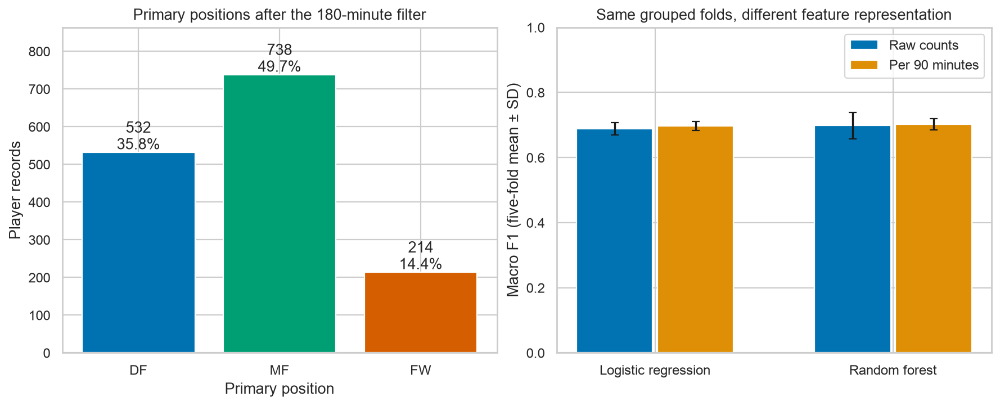
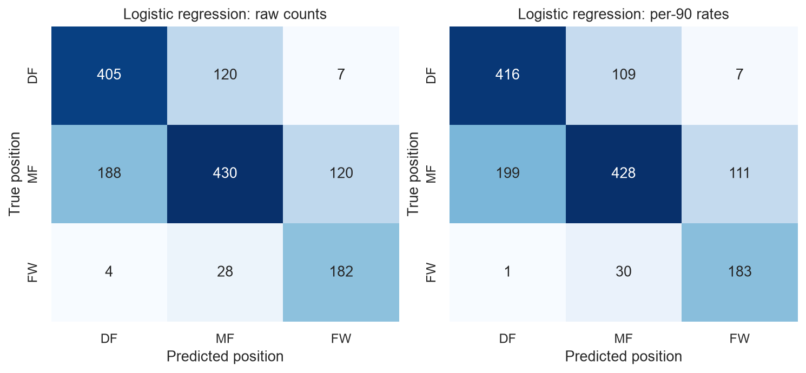

# Position data preparation and raw-count versus per-90 experiment

## Deliverables and main finding

`data/players_position_cleaned_min180.csv` is the primary **per-90** dataset:
**1,484 rows × 20 columns**, with target `Target` in DF/MF/FW.
`data/players_position_raw_counts_min180.csv` contains the identical players in the identical
order with raw event counts, for the controlled comparison. Both exclude player identifiers,
original/duplicate position labels, birth year, keeper statistics, and redundant merged fields.
Keep `Target` as **y**, never as an input feature. Neither file is globally imputed or scaled.

The strongest observed combination is **Random forest with per90**
(mean macro F1 **0.702**). This is an exploratory comparison of fixed
configurations, not an independent final test or a claim that normalization always helps.

## 1. Source audit

Source: `players_data-2026_2027.csv` (the full CSV extracted from `archive.zip`).
It contains **2,295 rows and 102 columns**. It has 0
exact duplicate records, 0 repeated Player/Squad pairs, and 36
additional rows sharing a stripped player name. Distinct club records are retained;
collapsing them without a documented aggregation rule would discard valid observations.
After filtering, 4 extra records share names; these names are grouped in CV.

| dtype | columns |
| --- | --- |
| float64 | 41 |
| int64 | 40 |
| str | 21 |

**42 columns contain missing values.** Keeper columns are mostly structurally
missing for outfield players. Ratios such as `G/SoT` and `SoT%` are often undefined when their
denominator is zero. The raw table has 3 missing ages and
3 missing birth years. After filtering, **2
ages remain missing**; they are retained for fold-local imputation. Audit files list every
column's original type, missing count, and cardinality, all 40 comparable merged
copies, and 44 exact same-type identical-column pairs. A suffix alone is not
proof of equality: `merged_column_audit.csv` measures agreement on overlapping nonmissing rows.

## 2. Every row-selection decision

| decision | removed_n | remaining_n |
| --- | --- | --- |
| Original full CSV | 0 | 2295 |
| Remove exact duplicate source records | 0 | 2295 |
| Exclude primary-position goalkeepers | 137 | 2158 |
| Exclude missing or unsupported primary positions | 0 | 2158 |
| Exclude missing, nonfinite, or nonpositive minutes | 0 | 2158 |
| Retain at least 180 minutes played | 674 | 1484 |
| Exclude missing player grouping identity | 0 | 1484 |

The steps above are sequential, so removals do not double-count players. `Pos` is split at
the first comma, whitespace is stripped, and the first token becomes `Target`. Thus
`MF,FW` becomes MF, while `FW,MF` becomes FW. This changes no rows by itself:
341 source records have multiple positions, and 247 retained
records receive their first listed role. Primary GK records are excluded. Rows whose
target or exposure cannot be established are excluded rather than having labels/minutes
invented. Exact duplicates are identified from the original source columns; the private
audit row index is excluded from that comparison.
There is no complete-case deletion based on predictors, outlier trimming, resampling,
deduplication by name alone, or label balancing by discarding majority examples.

## 3. Column choices, dates, and target leakage

- **Target:** preserve only the three-class `Target`. Drop `Pos`, `Pos_stats_keeper`,
  `Pos_stats_shooting`, `Pos_stats_playing_time`, `Pos_stats_misc`, and any other position
  copies from X. They directly disclose the answer. They are also absent from the exports.
- **Identifiers:** remove Player, row ranks, and Squad from predictors and exports. Player
  names are used only privately to separate repeated-player records across CV folds.
  Nationality is omitted as out-of-scope context, not described as a unique identifier.
- **Age versus birth year:** their Pearson correlation is **-0.9970**. They encode
  almost the same underlying age information, so retain Age and drop Born and all copies.
  They are not claimed to be exact numerical duplicates: birthdays/reference dates can
  account for a one-year difference. There is **no explicit match-date column**, so date
  parsing is unnecessary. Treating birth year as a match date, or inventing a reference
  date to recompute age, would add unsupported assumptions.
- **Exposure:** retain exact Min as a numerical covariate in both feature sets and use it
  to calculate rates. Drop the rounded `90s` and redundant playing-time summaries.
- **Event statistics:** retain the 16 canonical counts listed below, or their recalculated
  rates, once per experiment. Drop existing rounded `Sh/90` and `SoT/90`, the merged copies,
  redundant sums/differences such as G+A and G-PK, and unstable derived conversion ratios.
- **Keeper/team context:** drop keeper fields, including structurally missing values after
  excluding GK. Additional team-outcome and playing-time columns are outside the explicit
  allowlist; using all 102 fields would mix redundant summaries into this focused comparison.
- **Goals and assists are valid inputs here:** the target is **position**, not goals/assists.
  Their correlation with a role is useful behavioral information, not direct target leakage.
  They would be leakage when predicting contemporaneous goal contributions instead.

Column exclusion and engineering change the number of columns, not the 1,484
eligible rows. `column_decisions.csv` records a decision and reason for **every original
column**. `feature_conversion_audit.csv` records invalid-to-missing conversions. Invalid or
negative event counts become missing predictors; zero counts stay zero. Nonfinite values
become missing. Missing, nonpositive, nonfinite, or unparseable ages remain missing as well.

## 4. Per-90 features

For each count **c**, use `c_p90 = c * 90 / Min`. The retained minimum is
180 minutes, so no rate divides by zero. Exact minutes avoid rounding error
from the supplied `90s`. A missing count remains missing; it is never replaced by zero
without evidence. `TklW` measures **tackles won**, not every attempted tackle.

| Raw count | Per90 field | Meaning |
| --- | --- | --- |
| Sh | Sh_p90 | Shots |
| SoT | SoT_p90 | Shots on target |
| Crs | Crs_p90 | Crosses |
| Int | Int_p90 | Interceptions |
| TklW | TklW_p90 | Tackles won (not all attempted tackles) |
| Fls | Fls_p90 | Fouls committed |
| Fld | Fld_p90 | Fouls drawn |
| Off | Off_p90 | Offsides |
| Gls | Gls_p90 | Goals |
| Ast | Ast_p90 | Assists |
| PK | PK_p90 | Penalty goals |
| PKatt | PKatt_p90 | Penalty attempts |
| CrdY | CrdY_p90 | Yellow cards |
| CrdR | CrdR_p90 | Red cards |
| 2CrdY | 2CrdY_p90 | Second yellow cards |
| OG | OG_p90 | Own goals |

The primary CSV contains Age, Min, Comp, these 16 rates, and Target. The comparison CSV
contains the same three common covariates, 16 original counts, and Target. Per-90 values
describe event intensity and reduce exposure-driven differences, but two 90s of playing
time can still give noisy rates. No rate clipping is performed. Because **Min is included
in both views**, counts and rates are mathematically convertible: the experiment tests a
representation/inductive-bias change, not the addition of new information.

## 5. Class imbalance and missing-data pipelines

| Target | count | percent |
| --- | --- | --- |
| DF | 532 | 35.85% |
| MF | 738 | 49.73% |
| FW | 214 | 14.42% |

MF is 3.45 times as frequent as FW. A majority-only classifier can
reach 49.73% accuracy while never identifying the
other two roles. **Macro F1** gives each role equal weight and is the primary metric;
**balanced accuracy** averages class recalls. Per-class recall/F1 and the held-out confusion
matrices expose whether minority forwards are being missed.

Both learned models use `class_weight="balanced"`, recalculated from each training fold.
There is no oversampling/undersampling. Weighting may trade overall accuracy for minority
recall and does not guarantee equal performance. Natural validation prevalence is preserved.

Each sklearn Pipeline contains a ColumnTransformer. Numerical predictors receive
training-median imputation (`keep_empty_features=True`). Logistic regression then uses
StandardScaler, which is appropriate for its regularized coefficients. Random forests
receive imputation but no numerical scaling because their split thresholds do not require
common units. League (`Comp`) receives most-frequent imputation and OneHotEncoder with
`handle_unknown="ignore"`. Its categories, imputation values, and scaling moments are fitted
**only on the training fold**. A new validation league maps to an all-zero categorical vector.
All-missing training columns are preserved by the imputer rather than changing the schema.

The CSV intentionally keeps missing numerical values and the readable league label.
Exporting globally imputed/scaled values or fitting encoding before CV would contaminate
evaluation. Downstream users should fit the supplied pipeline on their training data;
the new CSV alone cannot contain a split-independent, already-fitted preprocessing step.

## 6. Raw counts versus per-90: calculated results

Use `StratifiedGroupKFold(5, shuffle=True, random_state=42)`, stratified by Target and
grouped by stripped Player name. All feature views and models use the **same saved indices**.
Repeated names never occur in both train and validation. Namesakes may be conservatively
grouped; a persistent player identifier would improve this design. Out-of-fold predictions
cover every retained row once. `fold_assignments.csv` permits reusing those splits with
either exported CSV, without exposing player identities.

Fixed models: logistic regression C=1, max_iter=2000; random forest 200 trees,
min_samples_leaf=3, seed=42; plus a most-frequent DummyClassifier. No hyperparameter search
or selection on these same validation predictions is used. Fold SDs are descriptive,
not confidence intervals, and overlapping training sets make folds dependent.

| representation | model | macro_f1 | balanced_accuracy | accuracy |
| --- | --- | --- | --- | --- |
| raw_counts | Majority baseline | 0.221 ± 0.000 | 0.333 ± 0.000 | 0.497 ± 0.002 |
| raw_counts | Logistic regression | 0.689 ± 0.019 | 0.732 ± 0.024 | 0.685 ± 0.017 |
| raw_counts | Random forest | 0.698 ± 0.040 | 0.727 ± 0.052 | 0.694 ± 0.036 |
| per90 | Majority baseline | 0.221 ± 0.000 | 0.333 ± 0.000 | 0.497 ± 0.002 |
| per90 | Logistic regression | 0.697 ± 0.014 | 0.739 ± 0.023 | 0.692 ± 0.016 |
| per90 | Random forest | 0.702 ± 0.018 | 0.725 ± 0.028 | 0.697 ± 0.016 |

- **Logistic regression:** per-90 minus raw-count macro F1 is **+0.008**; per-90 wins 3/5 paired folds.
- **Random forest:** per-90 minus raw-count macro F1 is **+0.004**; per-90 wins 2/5 paired folds.

The average macro-F1 gains are small relative to the reported fold variation and are not
consistent wins in every fold. They do not establish statistically significant superiority.
Other metrics can move differently: check balanced accuracy and the class-specific scores
before choosing a representation for a particular application.

| Position | Per90 logistic recall (mean) | Per90 logistic F1 (mean) |
| --- | --- | --- |
| DF | 0.782 | 0.725 |
| MF | 0.580 | 0.655 |
| FW | 0.855 | 0.711 |





The primary CSV uses per-90 features as requested, even if a raw-count configuration scores
better. Report the empirical winner rather than assuming normalization improves accuracy.
The results identify football roles from same-season behavior and do not establish future
performance or causal effects. Primary-label assignment simplifies genuinely hybrid roles;
recorded position can also depend on the source's labeling convention.

## Reproduce and inspect the audit

From the outer FootballAIProject directory:

```sh
.venv/bin/python AI_Football_Project/prepare_position_data.py
```

The original extracted CSV, archive, existing test.py, and earlier notebooks are unchanged.
`preprocessing_manifest.json` records the source hash, versions, feature allowlists, and
output hashes. No identifiers or duplicate target columns enter either exported feature set.
Full supporting tables: [source schema](source_schema.csv), [merged copies](merged_column_audit.csv),
[identical columns](identical_column_pairs.csv), [column decisions](column_decisions.csv),
[feature conversions](feature_conversion_audit.csv), [fold metrics](raw_vs_per90_fold_metrics.csv),
[paired differences](raw_vs_per90_paired_differences.csv), and [fold audit](fold_audit.csv).

Method references: [sklearn pipelines](https://scikit-learn.org/stable/modules/compose.html),
[stratified grouped validation](https://scikit-learn.org/stable/modules/generated/sklearn.model_selection.StratifiedGroupKFold.html),
and [balanced accuracy](https://scikit-learn.org/stable/modules/generated/sklearn.metrics.balanced_accuracy_score.html).
